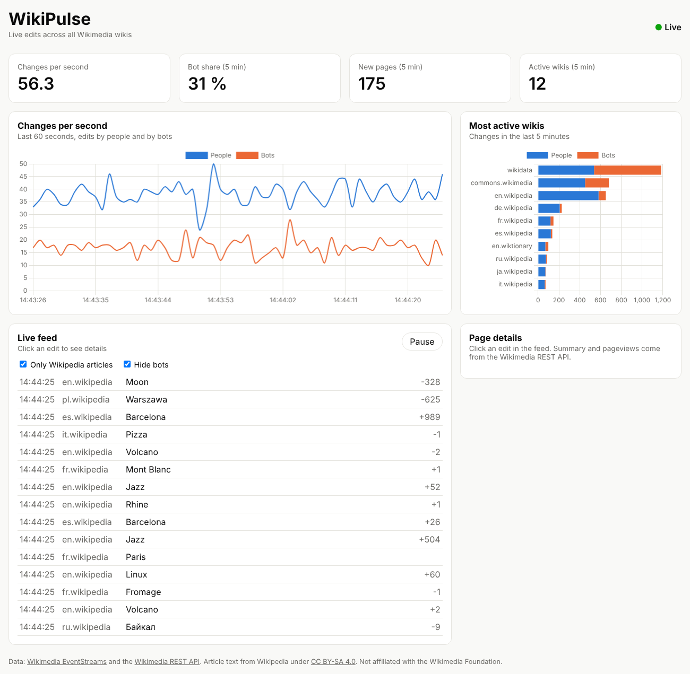

# WikiPulse

A live dashboard of edits on Wikipedia, Wikidata, Commons and all other Wikimedia wikis.

- **Live data:** the public [Wikimedia EventStreams](https://wikitech.wikimedia.org/wiki/Event_Platform/EventStreams_HTTP_Service)
  API sends every change as it happens (Server-Sent Events, no API key needed).
- **REST API:** click an edit to load the article's summary and its pageviews of the last
  30 days from the [Wikimedia REST API](https://www.mediawiki.org/wiki/Wikimedia_APIs).
- **Charts** with [Chart.js](https://www.chartjs.org/), plain JavaScript, built with [Vite](https://vite.dev/).
- **Docker:** built with Node.js, served by nginx.



## Run with Docker

```bash
docker compose up --build
```

Then open http://localhost:8080.

## Run without Docker

You need Node.js 22.12 or newer.

```bash
npm install
npm run dev     # development server: http://localhost:5173
npm test        # tests (Node's built-in test runner)
npm run build   # production build in dist/
```

## How it works

1. `src/stream.js` opens the live stream with the browser's `EventSource`. It reconnects
   by itself if the connection drops.
2. `src/stats.js` turns each event into a small object (wiki, title, user, bot or not, size of
   the change). The app keeps the changes of the last five minutes in an array.
3. Once per second, `src/main.js` calculates the numbers, updates the two charts
   (`src/charts.js`) and redraws the live feed.
4. When you click an edit, `src/api.js` loads the summary and pageviews of that article
   from the REST API.

```
Wikimedia stream ──SSE──▶ stream.js ──▶ stats.js ──▶ main.js ──▶ charts + feed
                                                       │
Wikimedia REST API ◀──fetch── api.js ◀── click on an edit
```

## Project structure

```
index.html          page layout
src/main.js         connects everything, updates the page every second
src/stream.js       live connection (Server-Sent Events)
src/stats.js        counting and filtering (pure functions, tested)
src/api.js          REST API calls (tested)
src/charts.js       Chart.js charts
src/style.css       styles, incl. dark mode
test/               tests for stats.js and api.js
Dockerfile          build with Node.js, serve with nginx
docker-compose.yml  start with one command
```

## CI/CD

GitHub Actions (`.github/workflows/ci.yml`) runs the tests, builds the app and the Docker
image on every push. Pushes to `main` are published on GitHub Pages
(in the repository: Settings → Pages → Source: GitHub Actions).

## Data and license

Data from Wikimedia EventStreams and the Wikimedia REST API. Article text from Wikipedia is
licensed under [CC BY-SA 4.0](https://creativecommons.org/licenses/by-sa/4.0/). This project
is not affiliated with the Wikimedia Foundation.

Code: [MIT](LICENSE)
